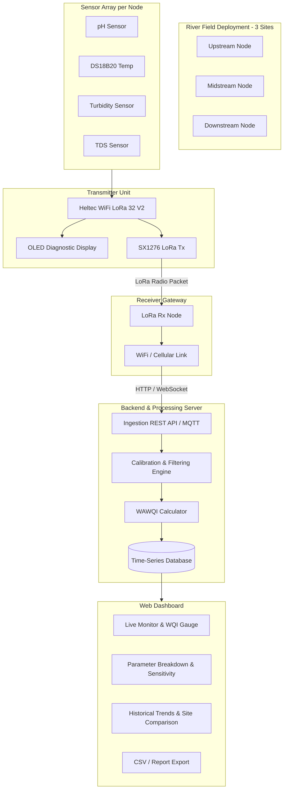

# Implementation Plan: Agosense / WaQuaCast (WAWQI-Focused Pipeline)

## 1. Architectural Overview & Paradigm Shift

### Key Changes from Initial Proposal
- **Eliminated**: Random Forest Regression model and machine learning classification/prediction layer.
- **Centered**: Rigorous **Weighted Arithmetic Water Quality Index (WAWQI)** calculation engine per the mathematical framework and DENR Administrative Order (DAO) 2016-08 standards.
- **Pipeline Architecture**: End-to-end hardware-to-cloud telemetry:
  1. **River Node**: Heltec WiFi LoRa 32 V2 gathers 4 parameters with local calibration and noise filtering.
  2. **LoRa RF Link**: Long-range telemetry broadcast across river sites.
  3. **Gateway Receiver**: Receives radio packets, validates integrity (CRC/RSSI), and forwards over internet (WiFi/GSM) to server.
  4. **Backend Server**: Stores historical data, calculates WAWQI, sub-indices $Q_i$, unit weights $W_i$, and classification.
  5. **Web Dashboard**: Real-time display of WQI ratings, classification badges, and historical analytics.

---

## 2. System Breakdown & Phases

### Phase 1: River Sensor Node Firmware (ESP32 + LoRa)
- **Base**: Expand [test_water-ml.ino](file:///d:/Agosense/test_water-ml.ino).
- **Sensors Integration**:
  - **pH Sensor**: Analog input with 2-point buffer calibration ($pH=4.01, 7.00$).
  - **Temperature Sensor**: DS18B20 (1-Wire, GPIO 17).
  - **Turbidity Sensor**: Analog input on GPIO 36 with voltage divider calculation ($R_1=10\text{k}\Omega, R_2=15\text{k}\Omega$) and empirical curve fitting ($y=ax^b$ or polynomial).
  - **TDS Sensor**: Analog input on GPIO 39 with real-time temperature compensation:
    $$EC_{25} = \frac{EC_T}{1 + 0.02(T - 25)}$$
- **On-Node Filtering**:
  - Sample averaging (20+ samples) and median spike rejection.
- **LoRa Packet Transmission**:
  - Compact binary struct or JSON payload containing: `node_id` (Upstream/Midstream/Downstream), `seq_num`, `temp_c`, `ph`, `turbidity_ntu`, `tds_ppm`, `battery_v`.
  - Configured frequency band (e.g. 433 MHz or 915/920–925 MHz AS923 compliant for Philippines).
  - Deep-sleep power management cycle (e.g., wake every 5–15 minutes, read, transmit, sleep).

### Phase 2: Gateway Receiver & Relay
- **Hardware Options**:
  - *Option A*: Second Heltec WiFi LoRa 32 V2 positioned within WiFi range, forwarding packets directly via HTTP POST or MQTT.
  - *Option B*: Raspberry Pi with LoRa HAT or USB serial connection to an ESP32 LoRa receiver, storing to local SQLite/Postgres and syncing with cloud.
- **Features**:
  - Packet integrity check, timestamping, and signal metric capture (RSSI, SNR).
  - Local buffer queue to prevent data loss during network hiccups.

### Phase 3: Backend Server & WAWQI Engine
- **Core WAWQI Computation** (per mathematical framework):
  1. **Ideal Values ($V_{0,i}$)**:
     - pH: $V_{0,\text{pH}} = 7.0$ (Deviation $|V_i - 7|$)
     - Turbidity: $V_{0,\text{Turb}} = 0$
     - TDS: $V_{0,\text{TDS}} = 0$
     - Temperature: $V_{0,T} = T_{\text{baseline}}$ (e.g., $25^\circ\text{C}$ or site ambient reference)
  2. **Standard Limits ($S_i$)**:
     - Configurable based on DENR DAO 2016-08 (Class AA, A, B, C, or D).
  3. **Quality Ratings ($Q_i$)**:
     $$Q_i = 100 \cdot \frac{V_i - V_{0,i}}{S_i - V_{0,i}}$$
  4. **Unit Weights ($W_i$)**:
     $$W_i = \frac{K}{S_i}, \quad K = \left(\sum_{i=1}^{n} \frac{1}{S_i}\right)^{-1}, \quad \sum W_i = 1$$
  5. **Overall Index**:
     $$\text{WAWQI} = \sum_{i=1}^{n} Q_i W_i$$
  6. **Classification**:
     - `0 – 25`: Excellent
     - `26 – 50`: Good
     - `51 – 75`: Poor
     - `76 – 100`: Very Poor
     - `> 100`: Unfit for Drinking
- **Sensitivity & Anomaly Flagging**:
  - Track individual $Q_i W_i$ contributions (highlighting dominant parameters like turbidity).
  - Monte Carlo or Delta method variance bounds based on sensor calibration residuals.

### Phase 4: Modern Web Interface
- **Dashboard Overview**:
  - River site selector (Upstream, Midstream, Downstream).
  - Hero Status Card with gauge meter for current WAWQI score, color-coded health status badge (Excellent / Good / Poor / Very Poor / Unfit).
  - Parameter Grid: Live readings for pH, Temperature, Turbidity, and TDS with individual status indicators against standard limits.
- **Analytical & Diagnostic Tools**:
  - **Contribution Breakdown Chart**: Donut or stacked bar chart illustrating each parameter's percentage contribution ($Q_i W_i$) to the total WAWQI.
  - **Time Series Trends**: Multi-axis interactive line charts with historical filters (Last 24h, 7 days, 14 days, custom date range).
  - **Comparative Site View**: Side-by-side comparison of Upstream vs Midstream vs Downstream.
  - **Data Export**: One-click download of raw sensor records, calibrated values, and computed WAWQI metrics in CSV/Excel.

---

## 3. Technology Stack Selection

| Component | Recommended Technology | Rationale |
| :--- | :--- | :--- |
| **Node Firmware** | C++ / Arduino Framework (ESP32) | Native support for Heltec LoRa, DS18B20 1-Wire, ADC calibration |
| **Gateway Node** | ESP32 (WiFi HTTP) or Node.js / Python on Raspberry Pi | Lightweight, stable LoRa-to-cloud bridge with buffering |
| **Backend API** | Node.js (Express / Fastify) or Python (FastAPI) | Fast JSON ingestion, asynchronous processing, scientific math libs |
| **Database** | PostgreSQL / SQLite / Supabase / InfluxDB | Structured time-series support for sensor telemetry and logs |
| **Frontend UI** | Modern Vanilla HTML5/CSS/JS or Vite + React/Vue | Responsive, fast load times, rich aesthetic with charts (Chart.js / ApexCharts) |

---

## 4. Work Breakdown & Action Items

1. **Refactor River Node Code**:
   - Add pH probe reading and calibration logic to [test_water-ml.ino](file:///d:/Agosense/test_water-ml.ino).
   - Integrate Heltec LoRa sender routine.
2. **Implement Gateway Receiver**:
   - Create receiver sketch for Heltec LoRa Rx -> WiFi HTTP POST.
3. **Build the Backend & WAWQI Calculator**:
   - Server route `/api/telemetry` to receive packets, evaluate WAWQI, and store to database.
4. **Develop the Web Application**:
   - Build a clean, glassmorphic UI displaying real-time metrics, WAWQI index, and parameter breakdowns.
